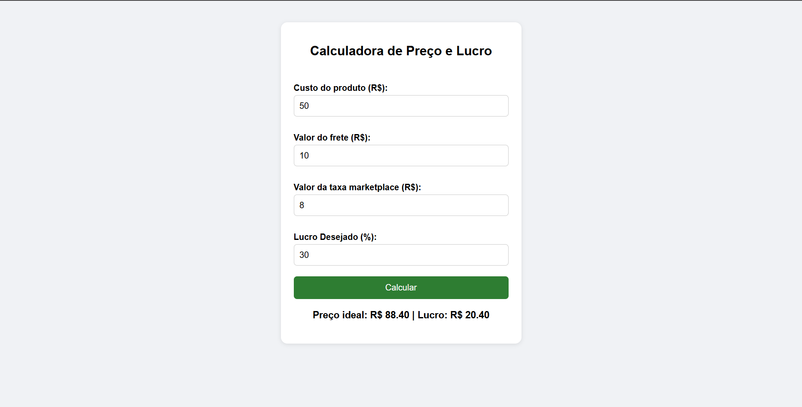

# Calculadora de Preço e Lucro

Calculadora simples que ajuda vendedores de marketplace a descobrir o preço de venda ideal.

🔗 **Teste aqui:** https://kaiodagdev.github.io/calculadora-preco-lucro/

## O que ela faz

Você informa o custo do produto, o frete, a taxa do marketplace (em R$) e o lucro desejado (em %). Ela mostra o preço ideal de venda e o lucro em reais.

## Como o cálculo funciona

- Gasto total = custo + frete + taxa
- Preço ideal = gasto total × (1 + lucro ÷ 100)
- Lucro em R$ = preço ideal − gasto total

Exemplo: custo 50, frete 10, taxa 8 e lucro de 30% resultam em preço de R$ 88,40 e lucro de R$ 20,40.
> **Atenção:** o lucro desejado é calculado sobre o gasto total, não sobre o preço de venda.

## Validações

A calculadora verifica os campos para evitar erros de cálculo como:
- 1 ou mais campos vazios
- 1 ou mais campos com valores negativos
- campo de custo com valor igual a 0

## Tecnologias

HTML, CSS e JavaScript (sem bibliotecas).

## Por que criei

Trabalho com e-commerce e precisava calcular preços de forma rápida e sem erro.

## Próximas melhorias

- Aceitar a taxa do marketplace em porcentagem
- Mostrar a margem de lucro sobre o preço de venda
- Adicionar botão para trocar entre idiomas (português e inglês)
- Adicionar botão para mudar o tema do site (para light mode e dark mode)
